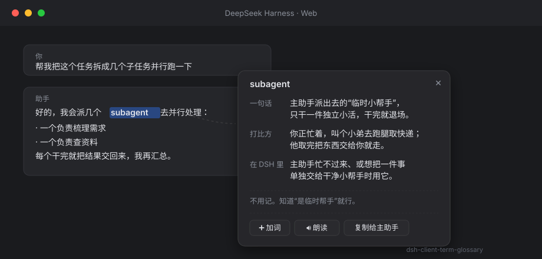
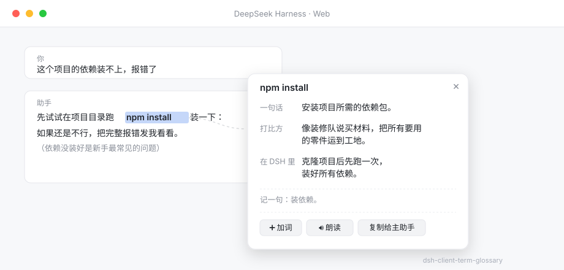

# dsh-client-term-glossary · 划词即解释

[](./LICENSE)
[](https://github.com/1qw23er/dsh-client-term-glossary/releases)
[](https://github.com/1qw23er/dsh-client-term-glossary)
[](#-技术细节-technical)
[](#-ai-解释optional)

> DSH (DeepSeek Harness) 客户端插件：选中任意文本即弹出大白话解释浮层，旁路进行，不打扰主任务。

A client-side plugin for [DSH](https://github.com/deepseek-ai) (DeepSeek Harness) that shows plain-language explanations when you select any text in the web UI. Zero interference with the main task — no session pollution, no AI calls for dictionary hits, no network for TTS.

---

## 📸 效果预览 Screenshots

**深色模式** — 选中 `subagent`，旁边浮出大白话解释：



**浅色模式** — 选中 `npm install`，显示命令组合解释（主题自动适配）：



---

## ✨ 功能 Features

| 功能 | 说明 |
|---|---|
| **139 条本地词典** | DSH 概念、AI 术语、编程基础、网络系统、报错关键词、常见命令组合，选中即弹大白话解释 |
| **模糊匹配** | 选中「什么是 subagent」「subagent 是什么意思」「Cordis.」都能命中 |
| **智能包含匹配** | 选中一句话，若其中只含一个已知术语，也能命中（多个术语时不猜，保持安静） |
| **命令组合识别** | `npm install`、`git commit`、`rm -rf`、`docker run` 等常见命令有独立解释 |
| **报错识别** | 选中报错文本（TypeError、ENOENT、ModuleNotFoundError…）给「怎么读这个错」的引导 |
| **通用卡片** | 选中任何 2~200 字符的文本都弹卡片——不在词典里的也能朗读 + 复制给主助手 |
| **🤖 AI 深入解释** | 词典没收录的，交给 AI 用「四行大白话」讲清楚。两条通道：Chrome 内置本地模型（免费离线）或浏览器直连 OpenRouter（可选，需自备 key） |
| **模型可配** | 可切换 OpenRouter 模型、调整 `max_tokens`，默认用又快又便宜的非推理模型，详见 [AI 解释](#-ai-解释optional) |
| **英文在线词典** | 选中英文单词自动查 [Free Dictionary API](https://dictionaryapi.dev/)，显示释义、词性、发音、例句 |
| **语音朗读 🔊** | 用浏览器原生 `speechSynthesis` 朗读选中文本，零联网、零额度、中英文皆可 |
| **深色模式适配 🌙** | 自动检测 DSH 深色/浅色主题，卡片配色跟随，不刺眼 |
| **卡片淡入动画** | 浮层出现时有轻微淡入效果，更自然不突兀 |
| **自定义词条 ➕** | 卡片底部「➕ 加词」，填表单即可添加自己的术语，存 localStorage 重启不丢 |
| **✍️ 填入输入框** | 一键把问题填进 DSH 输入框（追加式，不清空你已打的字），你确认后按回车发送 |
| **复制** | 复制选中文本到剪贴板，方便自己粘贴使用 |
| **零打扰保证** | 全部在浏览器内完成，不进 session 对话历史，不调用任何主助手工具 |

---

## 📦 安装 Install

### 通过 npm 安装（推荐）

在你的 DSH web profile 目录下：

```bash
# 进入 web profile 目录
cd ~/.dsh/profiles/web

# 安装插件
pnpm add dsh-client-term-glossary
# 或
npm install dsh-client-term-glossary
```

### 在 composition 里注册

编辑 `~/.dsh/profiles/web/cordis.patch.yml`，在 `insert` 列表里加一条：

```yaml
    # 划词即解释：选中术语浮出大白话解释，旁路不打扰主任务
    - id: term-glossary
      name: "dsh-client-term-glossary"
```

### 重启 DSH

重启 DSH host，然后刷新网页界面。选中任意术语即可看到解释浮层。

---

## 🎯 使用 Usage

1. 在对话正文或工具输出里，用鼠标**拖选**一个词或短语
2. 选区旁边立刻浮出一张解释卡片
3. 点 `×`、按 `Esc`、或点空白处关闭卡片

### 试试这些

| 选中内容 | 你会看到 |
|---|---|
| `subagent` | 本地词典：一句话 + 打比方 + 在 DSH 里怎么用 |
| `npm install` | 命令组合：「安装项目所需的依赖包」 |
| `什么是 HMR` | 模糊匹配：识别为 HMR，显示热更新解释 |
| `TypeError: Cannot read properties of undefined` | 报错识别：告诉你怎么读这个错 |
| `hello`（英文单词） | 在线词典：释义、词性、发音、例句 |
| `智能体`（中文，不在词典里） | 通用卡片：可朗读 + 复制给主助手 |
| `今天天气不错`（普通句子） | 通用卡片：可朗读 + 复制给主助手 |

---

### 卡片底部的按钮

| 按钮 | 做什么 | 会不会自动发送 |
|---|---|---|
| **🤖 AI 深入解释** | 让 AI 用四行大白话解释选中内容（旁路进行，不进会话） | ❌ 不会 |
| **🔑 设置 API Key** | 填 OpenRouter key、切换模型、调 `max_tokens` | — |
| **✍️ 填入输入框** | 把「这是什么意思」的提问填进 DSH 输入框 | ❌ 不会，你自己按回车才发 |
| **🔊 朗读** | 朗读选中的词 | — |
| **➕ 加词** | 添加自定义词条 | — |
| **复制** | 复制到剪贴板 | — |

> **关于「填入输入框」**：它通过 DSH 的 Lexical 编辑器插入文本，采用**追加**方式——如果你输入框里已经打了字，会把提问加到后面，**不会覆盖**。填入后卡片自动收起，你确认措辞没问题再按回车。

---

## 🔧 自定义 Customize

### 方式一：卡片上加词（推荐，不用改代码）

选中任意词弹出卡片后，点底部的 **「➕ 加词」**，填写：

- **术语**（多个用逗号分隔，如 `API, 接口`）
- **一句话解释** / **打比方** / **在 DSH 里**

点保存即可。词条存在浏览器 `localStorage`（key: `dsh-term-glossary-custom-v1`），**重启不丢**，下次选中就能看到。

> 清空自定义词条：浏览器控制台执行 `localStorage.removeItem('dsh-term-glossary-custom-v1')` 后刷新。

### 方式二：改代码内置

编辑 `lib/client.js` 中的 `GLOSSARY` 数组，照着已有条目加一项即可：

```javascript
{ terms: ['你的术语', '别名'], oneLine: '一句话解释', analogy: '生活比方', inDsh: '在 DSH 里怎么用', remember: '要记吗' },
```

### 命令组合

同样在 `GLOSSARY` 里加，`terms` 用完整命令：

```javascript
{ terms: ['your-command'], oneLine: '这是什么命令', analogy: '比方', inDsh: '说明', remember: '不用记。' },
```

---

## 🤖 AI 解释（Optional）

点「🤖 AI 深入解释」时，按以下顺序尝试：

### 通道 1 · Chrome 内置 AI（本地）
浏览器自带的小模型，**免费、离线、内容不出本机**。需要 Chrome 支持
`LanguageModel` API；不支持就自动跳到通道 2。

### 通道 2 · 浏览器直连 OpenRouter（云端）
浏览器直接 `fetch` OpenRouter，**非流式**，一次请求拿完整结果。
- 需要自备 OpenRouter API Key（存浏览器 `localStorage`，**不上传 DSH**）
- 通过卡片上的 **🔑 设置 API Key** 填写

> **为什么不用 DSH 的 `ctx.llm.stream`？**
> 实测该路径的输出经内部 `BlockAssembler` 组装后**返回空内容**（同一个请求
> 直连 OpenRouter 3 秒内正常返回）。因此 v1.4 起废弃 host RPC 通道，
> 改为浏览器直连；v1.8 已把相关 host 代码彻底移除。

### 模型选择

默认模型是 **`deepseek/deepseek-v4-flash`**。原因是一组实测对比
（同一请求，解释「BlockAssembler」）：

| 模型 | 耗时 | 完成 tokens | 其中推理 | 成本 |
|---|---|---|---|---|
| `deepseek/deepseek-v4.1-flash` | 23.3s | 2242 | 2168 | $0.00149 |
| **`deepseek/deepseek-v4-flash`** | **2.5s** | **43** | **0** | **$0.00004** |

推理模型会把绝大部分 token 花在 `reasoning` 上——实测有 96% 的完成 token
是推理。后果是**慢**、**贵**，而且 `max_tokens` 给小了会出现「推理把配额
吃光、正文为空」（`finish_reason: length` + `content: null`）。

因此：默认用非推理的 v4-flash（快约 9 倍、便宜约 36 倍），
`max_tokens` 默认 **4000**（可调 256–32000）。切到推理模型时建议提到 8000+。

---

## 🏗️ 技术细节 Technical

- **浏览器侧入口** `lib/client.js`：通过 `window.__ModuleLoader__.load({ id, factory })` 自注册，符合 DSH 客户端 bundle 契约（与官方 `dsh-client-hmr`、`dsh-client-locale` 同款格式）。
- **React 浮层**：用 `createPortal` 挂到 `document.body`，与 DSH 自身 UI 树隔离；容器 `all:initial` 隔离样式。
- **选区监听**：`mouseup`（延迟一帧）+ `selectionchange` + `mousedown`（capture），确保点击卡片不关闭、点空白处关闭。
  - ⚠️ 卡片内的输入框/下拉框有专门的 `isInsideCard()` 守卫：点输入框会导致选区塌缩，早先版本会因此误关浮层（v1.7 修复）。
- **匹配优先级**：精确匹配 > 模糊匹配（去提问式前后缀） > 智能包含匹配（多匹配取最长） > 报错识别 > 命令识别 > 通用卡片。
- **语音朗读**：浏览器原生 `speechSynthesis` API，自动选择中文/英文语音，`rate: 0.9`。
- **英文在线词典**：`fetch` 到 `api.dictionaryapi.dev`（免费、无需 API key、支持 CORS），失败时静默降级。
- **AI 通道 1**：Chrome 内置 `LanguageModel` API，`probe()` 先探测可用性，不可用则静默回退。
- **AI 通道 2**：浏览器直连 `openrouter.ai/api/v1/chat/completions`（非流式，`AbortController` 60s 超时）。key/模型/`max_tokens` 分别存 localStorage，`max_tokens` 读取时做范围钳制。
- **主题适配**：优先读 `data-theme` 属性 / `prefers-color-scheme`，再回退到 `body` 背景亮度检测（`0.299R+0.587G+0.114B < 0.5` 判定为深色）。
- **淡入动画**：注入 `@keyframes dsh-tg-fade-in`（`opacity` + `translateY` + `scale`，140ms），通过 `className` 应用。
- **自定义词条**：存 `localStorage['dsh-term-glossary-custom-v1']`，插件启动时合并进 `GLOSSARY` 数组。
- **host 半侧** `lib/index.js`：极简占位（`inject = []`），插件**不依赖任何 host 侧服务**——这样即使 DSH 内部服务改名/重构也不会激活失败。
- **全部 try/catch 兜底**：最坏情况只是浮层不出现，不会影响主界面。
- **回归测试**：`npm test`（46 项），覆盖焦点/关闭逻辑、云端配置钳制、死代码与版本一致性。

---

## 📋 系统要求 Requirements

- DSH ≥ 0.2.0（需支持 `window.__ModuleLoader__` 客户端 bundle 契约）
- 现代浏览器（Chrome 90+ / Edge 90+ / Firefox 90+）
- 语音朗读需要浏览器支持 `speechSynthesis`（主流浏览器均支持）

---

## 📄 License

[MIT](./LICENSE)

---

## 🤝 贡献 Contributing

欢迎提交 Issue 和 PR！

- 加词：直接编辑 `GLOSSARY` 数组
- 改进匹配逻辑：修改 `lookup` / `fuzzyHit` 函数
- 加新卡片类型：参考 `GlossaryCard` / `ErrorCard` / `CommandCard` / `UniversalCard` 的写法
